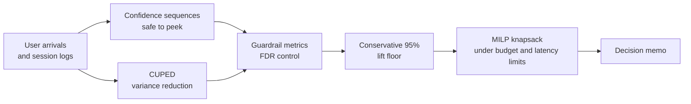

<!-- Profile README for github.com/saranlab (repo name must be: saranlab/saranlab) -->

<div align="center">


<a href="https://github.com/saranlab">
  
</a>

<br/>

<a href="https://www.linkedin.com/in/saran-rangsanthia-b09726372/"></a>
<a href="mailto:saranforwork0@gmail.com"></a>
<a href="https://opti-sim.vercel.app"></a>

</div>

---

## About

```python
class Saran:
    studying    = "B.S. Statistics @ Thammasat University"
    building    = ["LoanLens", "LoyalScale", "OptiSim"]
    cares_about = ["explainable models", "uncertainty quantification", "decisions, not just metrics"]
    organizing  = "QuantTU, a quant-finance + AI student group"
    looking_for = "Data Science internship"
```

I like models that end in a decision: *who do we approve, who do we call, which variant do we ship.*
Every project below goes past the accuracy number to the business action it supports.

---

## Projects

<table>
<tr>
<td width="33%" valign="top">

### LoanLens
**Credit-risk scorecard**

WoE + logistic scorecard on 150K loans with reason codes for declined applicants, a profit-maximizing approval cutoff, and a FastAPI + Streamlit service.

**AUC 0.855** &nbsp;|&nbsp; **131 tests in CI**

`Python` `scikit-learn` `LightGBM` `FastAPI` `Streamlit`

[Repository](https://github.com/saranlab/loanLens)

</td>
<td width="33%" valign="top">

### LoyalScale
**Churn diagnostic suite**

Stacked XGBoost / LightGBM / CatBoost tuned with Optuna, split conformal prediction (MAPIE), Cox PH time-to-churn, k-NN case explanations, and fuzzy schema mapping for uploaded CSVs.

**Banking ROC-AUC 0.88** &nbsp;|&nbsp; **~95% coverage**

`Python` `MAPIE` `Optuna` `lifelines` `Streamlit`

[Repository](https://github.com/saranlab/LoyalScale)

</td>
<td width="33%" valign="top">

### OptiSim
**Experimentation platform**

Anytime-valid sequential testing, CUPED variance reduction, FDR-controlled guardrails, Thompson Sampling, and a MILP rollout optimizer. FastAPI backend, Next.js frontend.

**66 tests** &nbsp;|&nbsp; **[live demo](https://opti-sim.vercel.app)**

`Python` `SciPy` `FastAPI` `Next.js` `HiGHS`

[Repository](https://github.com/saranlab/OptiSim)

</td>
</tr>
</table>

<details>
<summary><b>How OptiSim turns a test result into a rollout decision</b></summary>

<br/>



Peeking at a dashboard inflates false positives; confidence sequences stay valid at every look.
The optimizer then picks which features to roll out under real resource constraints.

</details>

<details>
<summary><b>Also: TU Class Check</b></summary>

<br/>

A course-scheduling web app I initiated after seeing classmates cross-check class and exam times by hand: course search, automatic conflict detection, a 4-year plan, and calendar export.
Led the product and UX design. [Try it](https://tuclasscheck.chukite.me)

</details>

---

## Toolbox

<div align="center">


</div>

<br/>

<div align="center">
  
</div>

---

## Elsewhere

- **Quant research:** WorldQuant Research Consultant (2025-26), WorldQuant Challenge Gold
- **Competitions:** Super AI Engineer Season 6, Thai document OCR with Typhoon-OCR
- **Teaching:** math tutoring (algebra, coordinate geometry); I like explaining things plainly

<div align="center">


</div>
